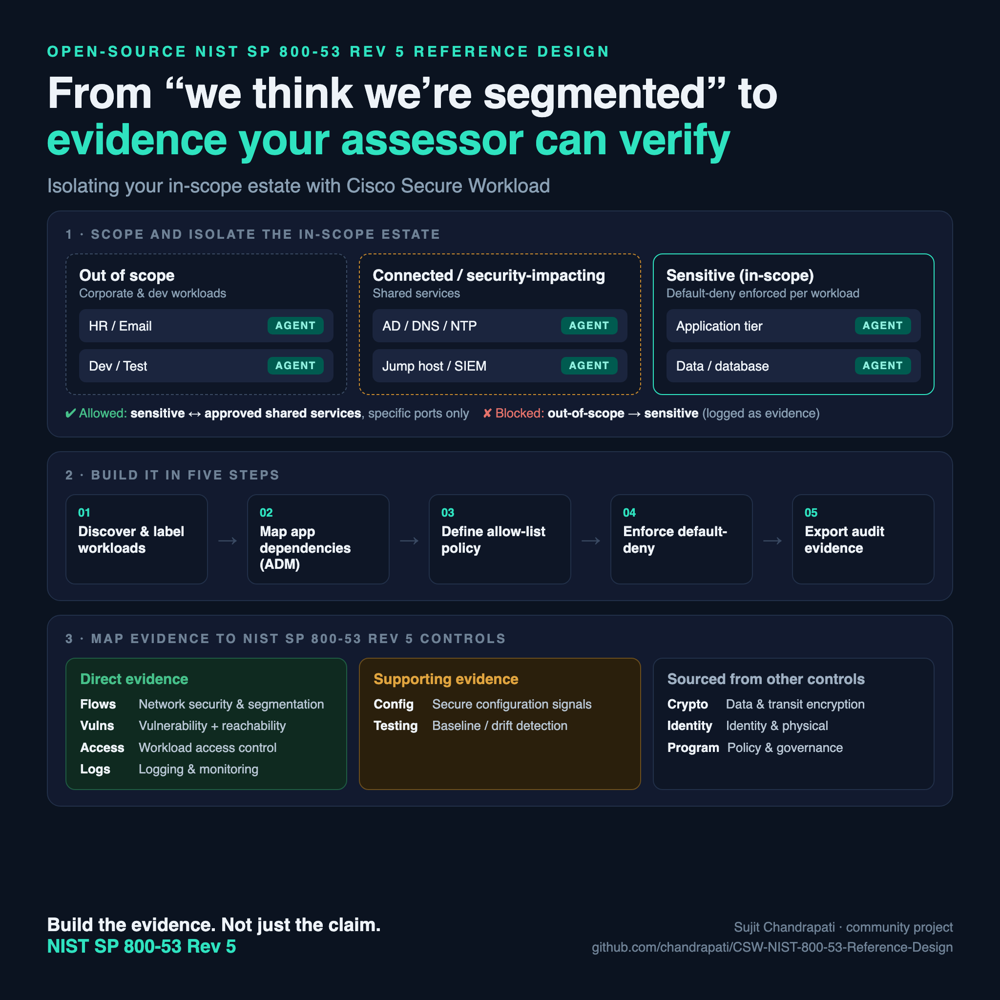
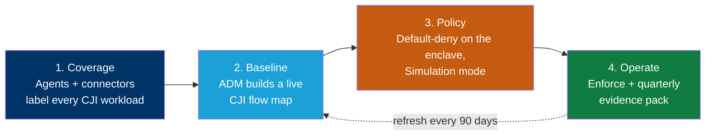

# Cisco Secure Workload — FBI CJIS Security Policy Reference Design





> A step-by-step blueprint for building **Cisco Secure Workload (CSW)** so a law-enforcement agency, court, corrections department, or CJI contractor can segment its **CJI enclave** and produce the **machine-generated evidence** a state CJIS Systems Agency auditor expects under the **FBI CJIS Security Policy (CJISSECPOL) v6.1** — segmentation, live flow maps, component inventory, vulnerability reachability, logging, and change-drift detection.

**There is no such thing as a "CJIS certified" product.** Each state's **CJIS Systems Agency (CSA)** audits *agencies* against the policy; vendors with CJI access sign a **CJIS Security Addendum** and have their staff background-checked. CSW does not certify CJIS compliance. It turns workload communication, process activity, and inventory into **evidence** that your agency, your LASO, and your CSA auditor can review. This repo shows how to stand that evidence up and keep it current between audit cycles.

---

## Why this maps cleanly to NIST 800-53

CJISSECPOL **v6.0** (12/27/2024, the "Policy Modernization" release) restructured the policy around **NIST SP 800-53 Rev 5 control families**, keeping only **Policy Area 1** (Information Exchange Agreements) and **Policy Area 20** (Mobile Devices) from the legacy 13-Policy-Area structure. **v6.1** (effective 06/25/2026) incorporates calendar-year 2025 changes.

If you have already built CSW against [NIST 800-53](https://github.com/chandrapati/CSW-NIST-800-53-Reference-Design), you have built most of this. What CJIS adds is a **specific, narrow, externally audited boundary** — the CJI enclave — plus a priority scheme that tells you which controls carry sanctions.

> ### Read this before customer use
>
> **Confirm which version your customer's CSA audits against.** It is frequently *not* the current version — several states run a lagging cycle (Texas DPS, for example, has audited against **v5.9.5** through 03/31/2027 while using v6.1 for gap assessments). An agency may be audited on v5.9.5 while remediating toward v6.1.
>
> **Confirm which requirements are sanctionable.** Per CJISSECPOL §1.4, from **October 1, 2024** the sanctionable set is requirements that existed prior to modernization (v5.9) **plus** those marked `[Priority 1]`. Priority 2–4 requirements sit in a **"zero-cycle"** status through **09/30/2027**.

**The commercially useful fact:** the controls where CSW produces *primary* evidence are overwhelmingly **Priority 1** — AC-3, AC-4, CM-7, CM-8, CA-7, RA-5, SC-7, and SI-4 are all sanctionable today. CSW is not helping with the optional part of the policy.

---

## What's in this repo

| Document | For | Use it to |
|---|---|---|
| **[Reference Design](CSW-CJIS-Reference-Design.md)** | SE / platform / security engineering | Build CSW end-to-end: scope architecture, labels, ADM, policy, enforcement, per-control evidence with Priority markings |
| **[Evidence Boundary](CSW-CJIS-Reference-Design.md#7-evidence-boundary--what-you-must-supply-outside-csw)** | Agency LASO, compliance, CSA auditor | Know exactly what CSW evidences and what must come from elsewhere |
| **[Evidence Checklist](docs/evidence-checklist.md)** | Evidence owner / LASO | A printable "what to export, from where, how often" worklist |
| **[POV / Workshop Plan](docs/pov-plan.md)** | SE + agency | Run a scoped 45-day proof-of-value on one CJI boundary |
| **[Platform Deployment Model](CSW-CJIS-Reference-Design.md#8-platform-deployment-model--can-csw-itself-be-saas)** | SE, agency IT, procurement | Answer "does CSW have to be on-prem, or can we use SaaS?" — with the policy's own test and the question set SaaS obliges you to work |
| **[CSA Audit Response Guide](CSW-CJIS-Reference-Design.md#9-csa-audit-response-guide)** | Anyone facing an auditor | Match each likely audit question to the exact artifact — including the questions CSW can't answer |

---

## How CSW produces evidence — the big picture



Each phase produces a specific, exportable artifact. The **[Reference Design](CSW-CJIS-Reference-Design.md)** maps every artifact to a control and marks whether that control is sanctionable.

---

## The CJI boundary

The scope tree *is* the answer to the question every CSA auditor opens with: which systems store, process, or transmit CJI?

```
Root Scope
└── CJIS
    ├── CJI-Enclave                      (stores, processes, or transmits CJI)
    │   ├── CJI-Applications             (RMS, CAD, JMS, case management)
    │   ├── CJI-Data-Stores              (criminal history, mugshot, biometric)
    │   └── State-Interface              (CSA message switch / NCIC / Nlets)
    ├── CJI-Adjacent                     (serves the enclave, holds no CJI)
    │   ├── Identity-Services
    │   ├── Logging-and-Monitoring
    │   └── Patch-and-Config-Mgmt
    ├── Privileged-Access-Paths          (AC-17 remote administration)
    ├── Non-CJI-Agency                   (general municipal / county IT)
    └── External
        ├── Internet-Edge
        └── Vendor-Remote-Support        (AC-20 — Security Addendum signatories)
```

Full inventory filters, the labeling strategy (`cji`, `cji_role`, `agency_ori`, `vendor_addendum`, `physically_secure_location`), and the enforced policy set are in the **[Reference Design §3–4](CSW-CJIS-Reference-Design.md#3-scope-architecture-and-labeling)**.

---

## Coverage snapshot

CSW provides **🟢 Direct** evidence for **11** controls, **🟠 Supporting** input for **10**, across **8** control families — and marks **⚪ Evidence Required** *(supplied outside CSW)* for **13** control families and policy areas.

**Coverage key**

- 🟢 **Direct** — CSW produces the **primary evidence** artifact for the control.
- 🟠 **Supporting** — CSW produces an **input that feeds or complements** another control's evidence.
- ⚪ **Evidence Required** *(supplied outside CSW)* — CSW produces **nothing** here. The control is **in scope for compliance but out of scope for CSW**; the agency supplies the evidence through **another control, tool, or process**. This marks a **boundary, not a gap or a failure.**

> Coverage describes what evidence CSW produces — **not** that a control is passed, and ⚪ never means a control is unsupported.

### Where CSW is the primary evidence source

| Control | Name | Priority | What CSW gives the auditor |
|---|---|---|---|
| **AC-3** | Access Enforcement | P1\* | Access to CJI systems permitted by rule, not by reachability |
| **AC-4** | Information Flow Enforcement | P1\* | Every observed flow crossing the CJI boundary, and the policy that blocks the rest |
| **SC-7** | Boundary Protection | P1 | Enclave boundary enforced east-west at the workload — including between systems sharing a VLAN |
| **CM-8** | System Component Inventory | P1 | A live enclave inventory instead of last year's spreadsheet |
| **CM-7** | Least Functionality | P1 | Every listening port and running process in the enclave, and what's blocked |
| **CA-7** | Continuous Monitoring | P1 | Continuous telemetry — the gap a triennial audit cycle leaves open |
| **RA-5** | Vulnerability Monitoring and Scanning | P1 | CVE exposure *plus reachability*, so an unreachable CVE is argued differently from an exposed one |
| **SI-4** | System Monitoring | P1 | Flow, process, and policy-violation monitoring with anomaly detection |
| **AU-2 / AU-3 / AU-12** | Event logging, record content, record generation | P2\* / P2 | Continuous flow + process telemetry with full 5-tuple, process hash, and UTC timestamps |

Every one of these is **sanctionable today**. The full table, including the 🟠 Supporting rows (AC-6, AC-17, AC-20, AU-6, CM-2, CM-3, CM-6, IR-4, IR-6, SI-7), is in **[Reference Design §2](CSW-CJIS-Reference-Design.md#2-control-family-mapping)**.

---

## Does CSW have to be on-premises, or can it be SaaS?

**The policy does not require on-premises.** CJISSECPOL **§2.2** is explicitly *Architecture Independent*, and Appendix G.3 asks the question directly — "Can an Agency be compliant with the CJIS Security Policy and also cloud compute?" — and answers **yes**, "assuming the vendor of the cloud technology is able to meet the existing requirements." It then adds the constraint that matters: *"device and architecture independence permits the use of cloud computing, but the security requirements do not change."*

**One test decides the burden**, and it is model-agnostic — "regardless of the implementation model – physical data center, virtual cloud solution, or a hybrid model":

> unescorted logical or physical access to any information system resulting in the **ability, right, or privilege to view, modify, or make use of unencrypted CJI**

The policy's own worked use cases resolve consistently: in the **IaaS** case, where the agency holds the keys, "no fingerprint-based background checks are required." In the **SaaS RMS** case, the provider *can* view and modify CJI, so personnel security applies to its staff — but **not** to the cloud provider underneath it. **Proximity to the CJI data, not the deployment model, drives the obligation.**

**Where CSW lands.** CSW ingests flow metadata, process names and hashes, hostnames, software inventory, and CVE findings. It does not ingest packet payloads, criminal history records, biometrics, or case data — it describes the workloads that handle CJI rather than carrying CJI. On the policy's own test that puts CSW nearer the IaaS/PaaS cases than the SaaS-RMS case. **But the determination belongs to the agency**, the policy says so explicitly, and there are two real counterarguments (the privileged agent and enforcement path into CJI hosts; the sensitivity of enclave telemetry) that **[§8.3](CSW-CJIS-Reference-Design.md#8-platform-deployment-model--can-csw-itself-be-saas)** states plainly so you can raise them before an auditor does.

| CSW deployment | Platform-compliance consequence |
|---|---|
| **On-premises cluster** in an agency-controlled, physically secure location | **Removes the question** — no telemetry leaves agency control, so no third-party access, addendum, or residency analysis for the platform |
| **On-premises in agency-controlled IaaS** | Inherits G.3's IaaS case; clean where the agency controls the environment and keys |
| **Cisco-hosted SaaS** | **Permitted**, but the agency must run the test, document the determination, and work the G.3 question set (§8.5) |

> **FedRAMP does not settle it.** The policy is explicit: assurances "such as FedRAMP, StateRAMP, SOC Type 2, etc., may be leveraged, however, they **do not guarantee compliance** with the CJIS Security Policy." CJISSECPOL v6.1 contains no FedRAMP requirement of its own.

**[§8.7](CSW-CJIS-Reference-Design.md#8-platform-deployment-model--can-csw-itself-be-saas)** lists the seven product facts to get from Cisco in writing — data residency, addendum willingness, CSA/FBI audit rights, screening posture, key custody, FIPS mode, and the telemetry inventory — rather than asserting any of them here.

---

## What CSW does **not** cover

This is the section that makes the rest of the mapping credible. Full detail in **[Reference Design §7](CSW-CJIS-Reference-Design.md#7-evidence-boundary--what-you-must-supply-outside-csw)**.

| Family / Area | Who evidences it |
|---|---|
| **AT** — Awareness and Training | Agency security-awareness programme, CJIS training records |
| **CP** — Contingency Planning | COOP / DR plan, backup testing records |
| **IA** — Identification and Authentication | IdP, MFA, advanced authentication — Cisco ISE and Duo, or equivalent |
| **MA** — Maintenance | Maintenance and escorted-maintenance records |
| **MP** — Media Protection | Media handling, sanitization, destruction |
| **PE** — Physical and Environmental Protection | Physically secure location controls, visitor logs |
| **PL / PM** — Planning, Program Management | Security plans, rules of behavior, programme governance |
| **PS** — Personnel Security | Fingerprint-based background checks, screening, termination |
| **SA / SR** — Acquisition, Supply Chain | Acquisition language, supplier assessments |
| **Policy Area 1** — Information Exchange Agreements | Signed agreements, management control agreements, CJIS Security Addenda |
| **Policy Area 20** — Mobile Devices | MDM, mobile policy, device encryption and wipe |

### Three boundaries that are routinely misread

**1. Encryption.** CJISSECPOL expects **FIPS 140-validated** cryptographic modules for CJI, including FIPS 140-2 validated encryption for CJI in transit outside a physically secure location, at a minimum of 128-bit symmetric encryption. **CSW does not encrypt application data.** What it does contribute is *detection* — the `Plaintext-On-CJI-Paths` filter identifies, with flow-level evidence, which CJI paths still run cleartext protocols. Useful input to the encryption programme; not the control. Separately, whether **CSW's own agent-to-cluster communication** runs in a FIPS mode acceptable to a CSA is a product-configuration question — **verify it with Cisco product management**, don't infer it.

**2. User-level CJI access auditing.** CSW audits the workload and the network. "Which named user accessed which criminal-history record, and under what right-to-know justification" lives in the RMS/CAD/case-management application and its database. Never in CSW. Scope this with the application team early.

**3. Deployment model.** If CJI is processed by a cloud-hosted service, the provider typically becomes a party to a CJIS Security Addendum, with the associated personnel-screening and jurisdictional obligations. SaaS versus on-premises changes **who owns which control**, so settle it before mapping anything.

> **No known official Cisco CJIS attestation exists for CSW.** Independently confirm Cisco's current position with Cisco compliance or product management before making any formal CJIS claim to a customer or auditor. Nothing in this repo is such an attestation.

---

## Start here

1. **Confirm the policy version** your customer's CSA audits against — v5.9.5 or v6.1 (see the callout above). This determines everything downstream.
2. **Settle the deployment model** — on-premises or SaaS (see the section above and **[§8](CSW-CJIS-Reference-Design.md#8-platform-deployment-model--can-csw-itself-be-saas)**). If SaaS, start the §8.5 question set with Cisco now; the answers have lead time.
3. Read the **[Reference Design](CSW-CJIS-Reference-Design.md)** — scope architecture, labels, and the AC-4 / SC-7 policy set.
4. Confirm the **CJI boundary** with the agency LASO, and run the under-scoping check (query workstations, reporting caches, enclave backups).
5. Run the **[POV plan](docs/pov-plan.md)** on that one boundary.
6. Track exports with the **[Evidence Checklist](docs/evidence-checklist.md)**.
7. Hand the agency the **[evidence-boundary statement](CSW-CJIS-Reference-Design.md#7-evidence-boundary--what-you-must-supply-outside-csw)** alongside the evidence — so nobody assumes CSW covered encryption, screening, or user-level access auditing.

---

## References & official sources

Authoritative source(s) for the **FBI CJIS Security Policy**. Always validate control references, priority markings, and version applicability against the current official text before customer use — the FBI revises this policy annually.

- [FBI CJIS Security Policy Resource Center](https://le.fbi.gov/informational-tools/cjis/cjis-security-policy-resource-center)
- [CJIS Division — FBI](https://www.fbi.gov/services/cjis)
- [NIST SP 800-53 Rev. 5](https://csrc.nist.gov/pubs/sp/800/53/r5/upd1/final) — the control catalog CJISSECPOL v6.x is built on
- Your state **CJIS Systems Agency (CSA)** — the authority on which policy version applies to a given agency
- Cisco Secure Workload — [product documentation](https://www.cisco.com/c/en/us/support/security/secure-workload/series.html)

---

## Disclaimer

This repository is for informational and planning purposes. It is **not** legal, regulatory, audit, or certification advice, and it is **not** a CJIS attestation — no such product attestation exists, and no product is "CJIS certified." CJIS compliance is determined by your **CJIS Systems Agency**, not by a vendor or a tool. Validate all control references, priority markings, and version applicability against the current official CJIS Security Policy text and your CSA, and confirm Cisco's position with Cisco compliance or product management before making any formal claim. Replace any bracketed fields before customer delivery.

---

*Part of the Cisco Secure Workload compliance reference-design series. Umbrella index: [CSW-Compliance-Mapping](https://github.com/chandrapati/CSW-Compliance-Reference-Designs).*
