# FBI CJIS Security Policy — CSW POV / Workshop Plan

A ~45-day proof-of-value that stands up CSW evidence on **one** CJI boundary. The goal is a repeatable evidence pack and app-owner confidence — not an estate-wide rollout.

> Scope the CJI enclave only. For a CJIS POV this is unusually tractable, because the enclave is a narrow, well-motivated boundary — resist the temptation to instrument general agency IT in the same window.

```mermaid
gantt
    dateFormat  X
    axisFormat  Day %s
    section Coverage
    Instrument + label           :a1, 0, 10
    section Baseline
    ADM observation (>=2 wks)     :a2, 10, 18
    App-owner signoff             :a3, 24, 4
    section Policy
    Author + Simulation (>=1 wk)  :a4, 29, 10
    section Operate
    Enforce + evidence pack       :a5, 39, 6
```

## Prerequisites

- The CJISSECPOL **version your CSA audits against** (see §1.2 of the Reference Design) — this determines which control set the readout is written to.
- Agency **ORI**(s), and a list of systems believed to store, process, or transmit CJI.
- Last CSA audit findings, if available, to align exports to what was actually asked for.
- Signed CJIS Security Addenda for any vendor in scope.
- Change-management contact for the enforcement step.

## Day-by-day

### Days 1–10 — Coverage
- Deploy agents to the CJI enclave, the jump hosts, and the state-interface systems; add cloud connectors for agentless inventory.
- Apply labels — `cji`, `cji_role`, `agency_ori`, `vendor_addendum` — and build the scope sub-tree.
- Record a **cannot-instrument register**; for CJIS this often includes appliance-form RMS components, and the register is itself evidence.
- Run the under-scoping check: query-capable workstations, reporting caches, and enclave backups.
- **Milestone:** 100% enclave coverage (or justified exceptions) + inventory export.

### Days 11–28 — Baseline
- Run ADM for a full business cycle (≥ 2 weeks; extend across month-end).
- Review discovered clusters with application owners; flag shadow IT, vendor egress, and scope creep.
- Confirm the `State-Interface` flow set with whoever owns the CSA message-switch connection.
- Run the `Plaintext-On-CJI-Paths` query early — findings here usually need lead time with the application team.
- **Milestone:** app owners sign the cluster-to-application mapping + ADM flow map exported.

### Days 29–45 — Policy → Operate
- Import ADM flows; set **default-deny** on `CJI-Enclave`; make each allow explicit; log the exception register.
- Run **Simulation ≥ 1 week** — every would-deny becomes a change ticket, not an outage.
- Enforce the absolute deny rules first (§4.1), particularly `Non-CJI-Agency → CJI-Enclave` and `Vendor-Remote-Support → CJI-Data-Stores`.
- Capture a negative test in Denied Connections.
- **Milestone:** enforcement live + first evidence pack assembled.

## Exit criteria

- [ ] 100% CJI enclave coverage (or documented exceptions)
- [ ] Signed ADM flow map = the live network-diagram artifact for the audit
- [ ] Default-deny enforced on the enclave with a logged denied connection
- [ ] Vendor access path report produced and reviewed against the Security Addendum
- [ ] Plaintext-on-CJI-paths report produced and routed to the encryption owner
- [ ] Simulation report + exception register filed
- [ ] An evidence binder the CSA auditor can consume without a live walkthrough

## Deliverables

- Evidence pack per the [Evidence Checklist](evidence-checklist.md)
- Policy + simulation exports and the exception register
- A short readout mapping each export to the CSA's audit questions (§8 of the Reference Design)
- An explicit **evidence-boundary statement** (§7) naming what the agency must evidence outside CSW

> Include the boundary statement in the readout. Agencies and auditors trust the mapping more when it marks its own limits, and it prevents the agency from assuming CSW has covered encryption, personnel screening, or user-level CJI access auditing.

*Tune cadence to the customer's audit cycle. Validate evidence sufficiency with your CSA. CSW evidence is an input to compliance, not an attestation, and no product is "CJIS certified."*
